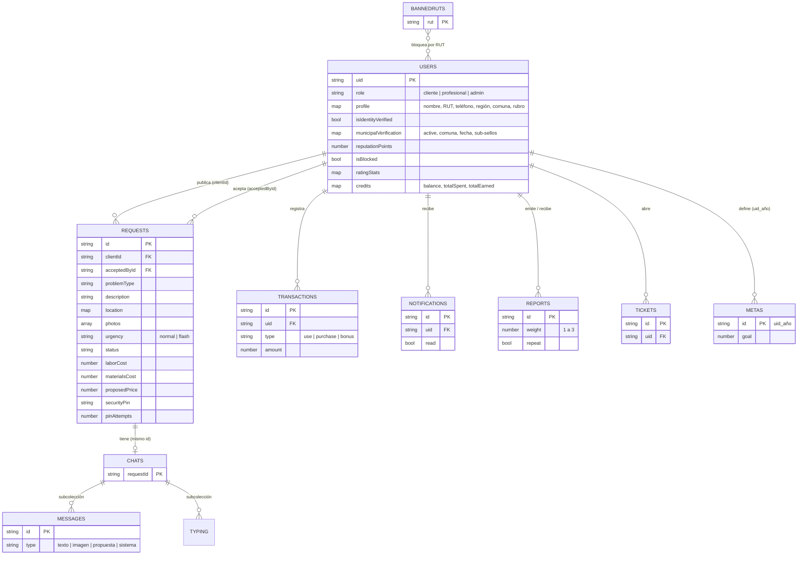
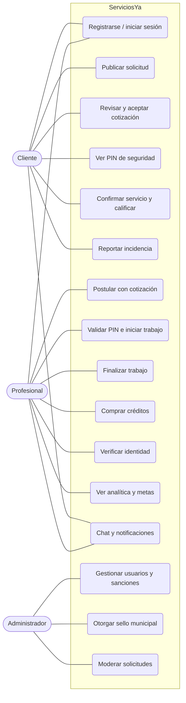
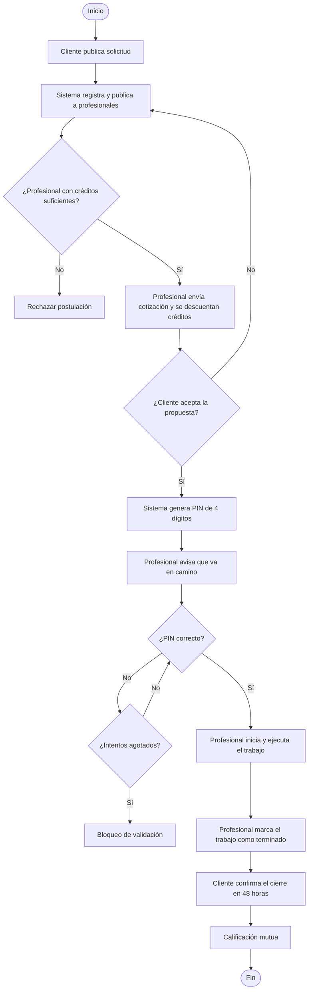
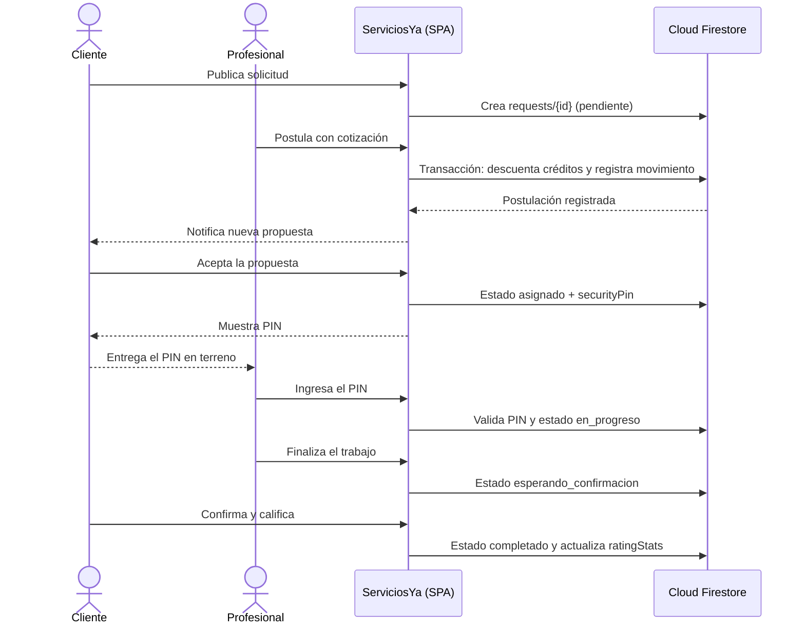
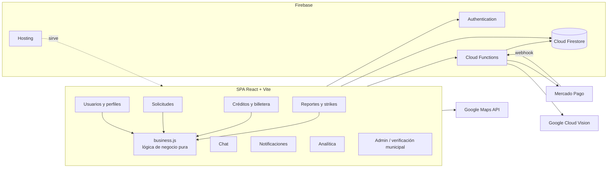

# ServiciosYa

**Red de confianza para trabajo independiente en Chile.** Marketplace que conecta
clientes con profesionales independientes de múltiples rubros —hogar, belleza,
arte, bienestar, educación, mascotas, transporte— a través de un sistema de
confianza en capas: verificación de identidad por IA, confirmación en terreno
por PIN de seguridad, doble calificación, sistema de strikes, y un nivel de
verificación institucional respaldado por la OMIL de la comuna del profesional.

Proyecto desarrollado para la asignatura **Capstone (PTY4614)**, Escuela de
Informática y Telecomunicaciones, Duoc UC, sede Plaza Norte (sección 006V).

> **Estado del proyecto (actualizado al 09-11-2026):** Sprint 7 de 9 en curso
> (02-11 al 13-11). Cierre y entrega final: 11-12-2026. Ver
> [Estado y planificación](#estado-y-planificación).

---

## Índice

- [Descripción](#descripción)
- [Estado y planificación](#estado-y-planificación)
- [Requisitos funcionales](#requisitos-funcionales)
- [Requisitos no funcionales](#requisitos-no-funcionales)
- [Tecnologías utilizadas](#tecnologías-utilizadas)
- [Arquitectura de la solución](#arquitectura-de-la-solución)
- [Modelo de datos](#modelo-de-datos)
- [Diagramas UML](#diagramas-uml)
- [Cómo ejecutar el proyecto localmente](#cómo-ejecutar-el-proyecto-localmente)
- [Variables de entorno](#variables-de-entorno)
- [Pruebas](#pruebas)
- [Despliegue con Docker](#despliegue-con-docker)
- [Integrantes del equipo](#integrantes-del-equipo)
- [Metodología de trabajo](#metodología-de-trabajo)
- [Seguridad](#seguridad)
- [Documentación adicional](#documentación-adicional)

---

## Descripción

ServiciosYa resuelve dos problemas al mismo tiempo: la informalidad de quienes
trabajan de forma independiente en Chile (gasfíteres, barberos, tatuadores,
psicólogos, entrenadores personales, etc.) y la falta de confianza real que
enfrenta un cliente al contratar a un desconocido para un servicio presencial.

> **Este repositorio es público y corre en modo simulado por defecto.** Las
> integraciones con Mercado Pago y Google Cloud Vision tienen un modo mock
> (activo de fábrica) que reemplaza esas llamadas externas por un flujo
> equivalente dentro de la propia app, para que cualquiera pueda clonar,
> instalar y probar el proyecto completo sin crear ninguna cuenta de pago ni
> de IA. Ver [`docs/PAGOS_Y_VERIFICACION.md`](docs/PAGOS_Y_VERIFICACION.md).

El diferenciador del proyecto es la capa de **verificación municipal**: un
profesional puede obtener el sello "Verificado por tu Municipalidad" a través
de la OMIL (Oficina Municipal de Información Laboral) de su comuna,
aprovechando el proceso de verificación de identidad y antecedentes que el
municipio ya realiza gratuitamente para inscribir a cualquier persona en su
bolsa de empleo. Ver `docs/INNOVACION.md` para el detalle del modelo.

### Las cuatro capas de confianza

| # | Capa | Cómo opera |
|---|---|---|
| 1 | Identidad verificada | OCR del documento (Google Cloud Vision) contrastado con el RUT de la cuenta |
| 2 | PIN en terreno | PIN aleatorio de 4 dígitos que el cliente entrega al profesional al iniciar el servicio |
| 3 | Reputación | Calificación mutua y strikes con suspensión automática a las 3 infracciones |
| 4 | Verificación municipal | Sello "Verificado por tu Municipalidad" y sub-sellos (OMIL/BNE, título, categoría migratoria) |

Funcionalidades principales:

- Publicación de solicitudes de servicio con fotos, ubicación y urgencia.
- Postulación de profesionales mediante un sistema de créditos.
- Confirmación de inicio de servicio mediante PIN de seguridad de 4 dígitos.
- Verificación de identidad automatizada (Google Cloud Vision).
- Nivel de verificación municipal (OMIL), adicional y opcional.
- Calificación mutua cliente ↔ profesional y sistema de strikes (suspensión
  automática a los 3 strikes).
- Billetera digital y panel de analítica de negocio para el profesional.
- Pagos vía Mercado Pago (compra de créditos y prioridad Flash).
- Chat en tiempo real por solicitud.
- Panel de administración (gestión de usuarios, verificación municipal,
  moderación de solicitudes).
- Catálogo único de 38 rubros en 11 categorías (`src/data/categories.js`).

## Estado y planificación

Scrum con 9 sprints de dos semanas (10-08-2026 al 11-12-2026). Fecha de
actualización de este documento: **09-11-2026**.

| Sprint | Fechas (2026) | Estado | Scrum Master | Product Owner | Developer |
|---|---|---|---|---|---|
| 1 | 10-08 al 21-08 | Cerrado | Sebastián Núñez | Maximiliano Navarrete | Salomón Abdo |
| 2 | 24-08 al 04-09 | Cerrado | Sebastián Núñez | Maximiliano Navarrete | Salomón Abdo |
| 3 | 07-09 al 18-09 | Cerrado | Sebastián Núñez | Maximiliano Navarrete | Salomón Abdo |
| 4 | 21-09 al 02-10 | Cerrado | Sebastián Núñez | Maximiliano Navarrete | Salomón Abdo |
| 5 | 05-10 al 16-10 | Cerrado | Salomón Abdo | Sebastián Núñez | Maximiliano Navarrete |
| 6 | 19-10 al 30-10 | Cerrado | Maximiliano Navarrete | Salomón Abdo | Sebastián Núñez |
| **7** | **02-11 al 13-11** | **En curso** | Sebastián Núñez | Maximiliano Navarrete | Salomón Abdo |
| 8 | 16-11 al 27-11 | Planificado | Salomón Abdo | Sebastián Núñez | Maximiliano Navarrete |
| 9 | 30-11 al 11-12 | Planificado | Maximiliano Navarrete | Salomón Abdo | Sebastián Núñez |

Los roles fueron fijos en los Sprints 1 a 4 y rotan desde el Sprint 5.

**Pendiente / hoja de ruta** (ver `docs/ARCHITECTURE.md`):

- Endurecimiento de reglas de Firestore para campos de confianza (rol, créditos, verificación, strikes).
- Validación del PIN en el servidor (hoy se valida en el cliente).
- Pruebas de reglas de seguridad con emuladores (CP-26) e integración continua (GitHub Actions).
- Corrección de las observaciones del linter (86 reportadas).
- Convenio real con una municipalidad (hito posterior al período académico).

## Requisitos funcionales

Roles: **Cliente**, **Profesional**, **Administrador**.

| ID | Requisito | Rol |
|---|---|---|
| RF-01 | Registrar usuarios con validación de RUT (módulo 11), mayoría de edad, teléfono y contraseña de mínimo 8 caracteres | Cliente / Profesional |
| RF-02 | Iniciar sesión, recuperar contraseña por correo y redirigir según rol; proteger rutas por rol | Todos |
| RF-03 | El profesional elige región, comuna y rubro desde el catálogo único; recibe 10 créditos de bienvenida | Profesional |
| RF-04 | Publicar solicitudes en 5 pasos (servicio, fotos, ubicación, agenda, confirmar), hasta 3 fotos de 5 MB, urgencia normal o Flash | Cliente |
| RF-05 | Listar solicitudes disponibles con filtro por rubro y categoría, ordenadas por urgencia y distancia | Profesional |
| RF-06 | Postular con cotización (mano de obra, materiales, detalle) descontando créditos (4 normal, 6 urgente) de forma atómica | Profesional |
| RF-07 | Aceptar una propuesta y generar un PIN de seguridad de 4 dígitos visible solo para el cliente | Cliente |
| RF-08 | Avisar "voy en camino", validar el PIN con límite de intentos, iniciar y finalizar el trabajo | Profesional |
| RF-09 | Confirmar el término del trabajo (plazo de 48 horas) y calificar a la contraparte con estrellas y etiquetas | Cliente / Profesional |
| RF-10 | Reportar conductas con peso (1 a 3); aplicar strikes y bloquear la cuenta al llegar a 3 | Todos / Sistema |
| RF-11 | Verificar identidad del profesional por cámara mediante Cloud Function (OCR del RUT) | Profesional |
| RF-12 | Otorgar y revocar el sello municipal y los sub-sellos, consultando por RUT e indicando la comuna que certifica | Administrador |
| RF-13 | Mostrar en el perfil público el nivel de verificación (básico, identidad, municipal), calificaciones y avisos de conducta, sin exponer el RUT | Cliente |
| RF-14 | Comprar paquetes de créditos (10 por $5.000, 30 por $12.000, 60 por $20.000) con Mercado Pago y acreditarlos vía webhook | Profesional |
| RF-15 | Consultar la billetera: saldo, gastos, ingresos y movimientos filtrables | Profesional |
| RF-16 | Chat en tiempo real por solicitud con indicador de escritura, imágenes y tarjeta de propuesta | Cliente / Profesional |
| RF-17 | Recibir notificaciones (nueva propuesta, propuesta aceptada, strike) con marcado de lectura | Todos |
| RF-18 | Panel de analítica: ingresos, evolución mensual, distribución por tipo de trabajo, metas anual y mensual, exportación CSV | Profesional |
| RF-19 | Suspender/reactivar usuarios, reiniciar strikes, banear por RUT y moderar o eliminar solicitudes | Administrador |
| RF-20 | Centro de ayuda y formulario de contacto que generan tickets | Todos |

## Requisitos no funcionales

| ID | Categoría | Requisito | Estado |
|---|---|---|---|
| RNF-01 | Seguridad | Credenciales fuera del código fuente, en variables de entorno no versionadas | Cumplido |
| RNF-02 | Seguridad | Reglas de Firestore con denegación por defecto y reglas por colección | Cumplido (campos de confianza pendientes) |
| RNF-03 | Seguridad | Operaciones con credenciales de terceros (pagos, Vision) solo en Cloud Functions | Cumplido |
| RNF-04 | Seguridad | Validación del PIN y aplicación de strikes en el servidor | Pendiente (hoja de ruta) |
| RNF-05 | Integridad | Descuento de créditos y registro del movimiento en una misma transacción de Firestore | Cumplido |
| RNF-06 | Privacidad | No exponer RUT ni certificados en perfiles públicos; consentimiento revocable para la verificación municipal; minimización de datos | Cumplido en el modelo |
| RNF-07 | Rendimiento | Carga diferida por ruta (`React.lazy`) y separación de librerías pesadas en chunks | Cumplido |
| RNF-08 | Rendimiento | Imágenes comprimidas en el navegador (~300 KB, máx. 900 px) | Cumplido |
| RNF-09 | Disponibilidad | Infraestructura gestionada (Firebase Hosting, Auth, Firestore, Functions) | Cumplido |
| RNF-10 | Escalabilidad | Arquitectura serverless con índices compuestos definidos para cada consulta | Cumplido |
| RNF-11 | Mantenibilidad | Lógica de negocio aislada en `src/lib/business.js`; catálogo único de rubros | Cumplido |
| RNF-12 | Calidad | Pruebas unitarias automatizadas (Vitest) sobre la lógica crítica | Cumplido (25 pruebas) |
| RNF-13 | Calidad | Análisis estático sin errores (ESLint) | Pendiente (86 observaciones) |
| RNF-14 | Portabilidad | Entorno reproducible con Docker y Docker Compose | Cumplido |
| RNF-15 | Usabilidad | Formularios por pasos, indicador de fortaleza de contraseña, dirección manual si no hay clave de Maps | Cumplido |
| RNF-16 | Documentación | Carpeta `docs/` con arquitectura, modelo de datos, pagos, innovación y Docker | Cumplido |
| RNF-17 | Cumplimiento | Tratamiento de datos conforme a la normativa chilena de protección de datos personales | Definido en el modelo de convenio OMIL |

## Tecnologías utilizadas

| Capa | Tecnología |
|---|---|
| Frontend | React 19, Vite 7, React Router 7, Tailwind CSS, Recharts |
| Backend | Firebase Cloud Functions (Node.js), Firebase Admin SDK |
| Base de datos | Cloud Firestore (NoSQL) |
| Almacenamiento de imágenes | Imágenes comprimidas en el navegador y guardadas en Firestore (Firebase Storage requiere plan de pago; las reglas de Storage quedan definidas por si se habilita) |
| Autenticación | Firebase Authentication (correo y contraseña) |
| Pagos | Mercado Pago (Checkout Pro / API) |
| Verificación de identidad | Google Cloud Vision API |
| Mapas / geocodificación | Google Maps JavaScript API (Places) |
| Pruebas | Vitest |
| Contenedores | Docker / Docker Compose (Nginx + emuladores de Firebase) |

## Arquitectura de la solución

```
┌──────────────────┐        ┌───────────────────────┐        ┌─────────────────────┐
│   Cliente (SPA)   │  HTTPS │   Firebase Hosting     │        │  Cloud Functions     │
│  React + Vite     │◄──────►│   (dist/ estático)     │        │  (Node.js, backend)  │
└─────────┬─────────┘        └───────────────────────┘        └──────────┬───────────┘
          │  Firebase SDK (Auth / Firestore)                              │
          │                                                               │ Admin SDK
          ▼                                                               ▼
┌───────────────────────────────────────────────────────────────────────────────┐
│                              Firebase / Google Cloud                          │
│  ┌───────────────┐   ┌─────────────────┐                     ┌───────────┐    │
│  │ Authentication │   │ Cloud Firestore │                     │  Vision   │    │
│  │                │   │  (users,        │                     │  API (IA) │    │
│  │                │   │   requests,     │                     │           │    │
│  │                │   │   chats, ...)   │                     │           │    │
│  └───────────────┘   └─────────────────┘                     └───────────┘    │
└───────────────────────────────────────────────────────────────────────────────┘
          ▲
          │ REST / Webhook
          ▼
┌───────────────────┐
│    Mercado Pago     │
│  (Checkout Pro)     │
└───────────────────┘
```

El frontend es una SPA que habla directamente con Firebase (Auth, Firestore)
para la mayoría de las operaciones, protegida por reglas de seguridad
(`firestore.rules`, `storage.rules`). Las operaciones que requieren una
credencial sensible pasan por Cloud Functions, que son las únicas que usan
esas credenciales (nunca el frontend):

| Función | Responsabilidad |
|---|---|
| `validateIdentityIA` | OCR del documento con Vision, compara con el RUT de la cuenta autenticada y marca `isIdentityVerified` |
| `crearPago` | Preferencia de Mercado Pago para la prioridad Flash |
| `comprarCreditosMP` | Preferencia de Mercado Pago para paquetes de créditos |
| `mpWebhook` | Aplica el efecto del pago aprobado (acreditar créditos o marcar prioridad) |

Las reglas críticas de negocio viven en el módulo puro `src/lib/business.js`
(PIN, `STRIKE_LIMIT = 3`, niveles de verificación, créditos), sin dependencias
de React ni de Firebase.

Ver `docs/ARCHITECTURE.md` para el detalle y las decisiones de diseño.

## Modelo de datos

Base de datos Cloud Firestore (NoSQL). Las relaciones se resuelven por
referencia de identificador (`uid` o `requestId`) con consultas `where(...)`.



**Estados de una solicitud:** `pendiente`, `asignado`, `en_progreso`,
`esperando_confirmacion`, `completado`, `cancelado_cliente`,
`cancelado_profesional`.

**Índices compuestos** (`firestore.indexes.json`), por ejemplo
`status + problemType + createdAt` (trabajos disponibles por rubro) y
`acceptedById + status + createdAt` (Mis Trabajos). Detalle en
[`docs/MODELO_DATOS.md`](docs/MODELO_DATOS.md).

## Diagramas UML

Los diagramas están escritos en [Mermaid](https://mermaid.js.org/), que GitHub
renderiza directamente en el README.

### Casos de uso



### Diagrama de actividades: contratación de un servicio



### Diagrama de secuencia: solicitud, PIN y cierre



### Diagrama de componentes



## Cómo ejecutar el proyecto localmente

### Requisitos previos

- Node.js 20 o superior (recomendado: la misma versión que `functions/package.json` declara, Node 24)
- Una cuenta de Firebase con un proyecto creado (Firestore, Auth y Functions habilitados) — este sí es imprescindible, es la base de datos y autenticación de la app.
- **No se necesita** cuenta de Mercado Pago ni de Google Cloud Vision para probar el proyecto: ambas corren en modo simulado por defecto (ver [`docs/PAGOS_Y_VERIFICACION.md`](docs/PAGOS_Y_VERIFICACION.md)).
- Opcional: una clave de Google Maps API con Places habilitado (si no se configura, el paso de dirección usa un formulario manual sin mapa).

### 1. Clonar e instalar dependencias

```bash
git clone <url-del-repositorio>
cd ServiciosYa

# Frontend
npm install

# Backend (Cloud Functions)
cd functions
npm install
cd ..
```

### 2. Configurar variables de entorno

```bash
cp .env.example .env
cp functions/.env.example functions/.env
```

Completa ambos archivos `.env` con tus propias credenciales (ver sección
[Variables de entorno](#variables-de-entorno)). **Nunca subas estos archivos
a git** — ya están excluidos en `.gitignore`.

### 3. Ejecutar en modo desarrollo

```bash
# Frontend (http://localhost:5173)
npm run dev

# Backend, en otra terminal (emuladores de Firebase)
cd functions
npm run serve
```

### 4. Compilar para producción

```bash
npm run build     # genera la carpeta dist/
npm run preview   # sirve el build localmente para verificarlo
```

## Variables de entorno

### Frontend (`.env`, ver `.env.example`)

| Variable | Descripción |
|---|---|
| `VITE_GOOGLE_MAPS_API_KEY` | Clave de Google Maps (Places/Autocomplete) |
| `VITE_FIREBASE_API_KEY` | Configuración web de Firebase |
| `VITE_FIREBASE_AUTH_DOMAIN` | Configuración web de Firebase |
| `VITE_FIREBASE_PROJECT_ID` | Configuración web de Firebase |
| `VITE_FIREBASE_STORAGE_BUCKET` | Configuración web de Firebase |
| `VITE_FIREBASE_MESSAGING_SENDER_ID` | Configuración web de Firebase |
| `VITE_FIREBASE_APP_ID` | Configuración web de Firebase |

### Backend (`functions/.env`, ver `functions/.env.example`)

| Variable | Descripción |
|---|---|
| `PAYMENTS_MODE` | `mock` (por defecto) o `live`. Ver [`docs/PAGOS_Y_VERIFICACION.md`](docs/PAGOS_Y_VERIFICACION.md) |
| `IDENTITY_VERIFICATION_MODE` | `mock` (por defecto) o `live`. Ver [`docs/PAGOS_Y_VERIFICACION.md`](docs/PAGOS_Y_VERIFICACION.md) |
| `MP_ACCESS_TOKEN` | Token de acceso de Mercado Pago (solo necesario si `PAYMENTS_MODE=live`) |
| `GOOGLE_APPLICATION_CREDENTIALS` | Ruta al JSON de la cuenta de servicio de Google Cloud (solo necesaria si `IDENTITY_VERIFICATION_MODE=live`, y solo en desarrollo local) |

## Pruebas

```bash
npm run test         # corre la suite una vez
npm run test:watch   # modo watch para desarrollo
```

Las pruebas cubren la lógica de negocio central (`src/lib/business.js`).
Esta lógica se extrajo de los componentes de página a un módulo aparte
específicamente para poder probarla sin depender de React ni de Firebase.

| Función | Pruebas |
|---|---|
| `generateSecurityPin` | 3 |
| `validateSecurityPin` | 5 |
| `getReputationStatus` / `STRIKE_LIMIT` | 5 |
| `getVerificationLevel` | 5 |
| `pricePerCredit` | 3 |
| `hasSufficientCredits` | 4 |
| **Total** | **25** |

**Plan de pruebas (09-10-2026):** 26 casos, 24 aprobados, 1 fallido
(CP-08, análisis estático con ESLint: 86 observaciones) y 1 pendiente
(CP-26, pruebas de reglas de Firestore con emuladores).

## Despliegue con Docker

El frontend se construye y sirve en un contenedor Nginx (Dockerfile
multietapa: build con Node 20 y servicio estático con Nginx), y el backend se
levanta localmente con los emuladores de Firebase. Ambos se orquestan con
Docker Compose.

```bash
docker compose up --build
```

| Servicio | Contenido | URL |
|---|---|---|
| `frontend` | SPA compilada servida por Nginx | http://localhost:8080 |
| `emuladores` | Emuladores de Firebase (Auth, Firestore, Functions) y su UI | http://localhost:4000 |

Comandos útiles:

```bash
docker compose up --build -d   # levantar en segundo plano
docker compose logs -f         # ver logs
docker compose down            # detener y eliminar los contenedores
```

Requisitos: Docker Desktop (o Docker Engine con el plugin Compose). No hace
falta configurar credenciales de Mercado Pago ni de Vision: la app corre en
modo `mock` por defecto. El detalle de cada imagen está en
[`docs/DOCKER.md`](docs/DOCKER.md).

## Integrantes del equipo

| Integrante | Área técnica |
|---|---|
| Maximiliano Navarrete | Frontend y producto |
| Salomón Abdo | Backend y datos |
| Sebastián Núñez | QA y documentación |

Los roles Scrum rotan por sprint desde el Sprint 5 (ver
[Estado y planificación](#estado-y-planificación)).

## Metodología de trabajo

Scrum, con 9 sprints de dos semanas (10-08-2026 al 11-12-2026) alineados a las
fases de la asignatura Capstone. Cada sprint incluye planificación, desarrollo,
revisión y retrospectiva, con un Product Backlog priorizado en historias de
usuario. El equipo mantiene tres registros: roles rotativos, riesgos (17) y
cambios (17). Detalle completo de objetivos, plan de trabajo y carta Gantt en
el Informe Final de la Fase 2 (fuera de este repositorio).

## Seguridad

- Ninguna credencial (tokens de pago, llaves de servicio, configuración de
  Firebase) está escrita en el código fuente: todas se cargan desde
  variables de entorno no versionadas (ver `.gitignore`).
- Las reglas de Firestore aplican denegación por defecto y restringen cada
  colección según el usuario autenticado (por ejemplo, transacciones y tickets
  legibles solo por su dueño, notificaciones solo por el destinatario, lista de
  RUT baneados escribible solo por administradores, reportes inmutables).
- La verificación de identidad se centraliza en una Cloud Function que valida
  que el RUT pertenezca a la cuenta autenticada.
- El descuento de créditos y su registro ocurren en una misma transacción de
  Firestore.
- El sistema de strikes suspende automáticamente cualquier cuenta al llegar
  a 3 infracciones (`STRIKE_LIMIT` en `src/lib/business.js`).

**Limitaciones conocidas** (en la hoja de ruta, riesgos R-12 y R-13, defecto
D-03): los campos de confianza (verificación, rol, créditos y strikes) y la
lectura de datos aún no están restringidos por las reglas, y el PIN se valida
en el cliente. Ver `docs/ARCHITECTURE.md`.

## Documentación adicional

| Documento | Contenido |
|---|---|
| [`docs/ARCHITECTURE.md`](docs/ARCHITECTURE.md) | Arquitectura, hallazgos de la auditoría y limitaciones de seguridad |
| [`docs/MODELO_DATOS.md`](docs/MODELO_DATOS.md) | Colecciones de Firestore, relaciones e índices |
| [`docs/PAGOS_Y_VERIFICACION.md`](docs/PAGOS_Y_VERIFICACION.md) | Pagos y verificación de identidad, modos `mock` y `live` |
| [`docs/INNOVACION.md`](docs/INNOVACION.md) | Modelo de verificación municipal (Pasaporte de Confianza Vecinal) |
| [`docs/DOCKER.md`](docs/DOCKER.md) | Imágenes y orquestación con Docker Compose |
